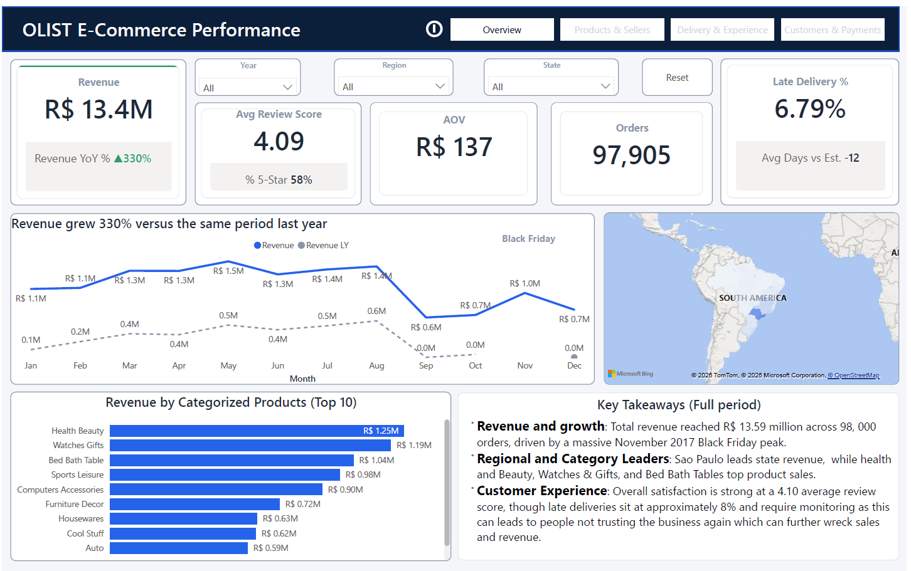
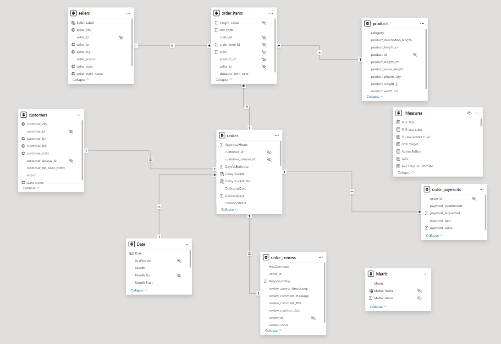
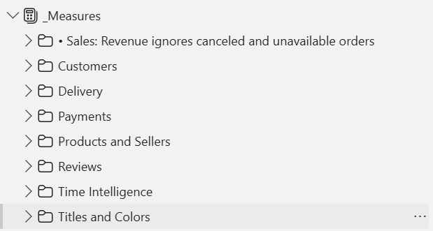
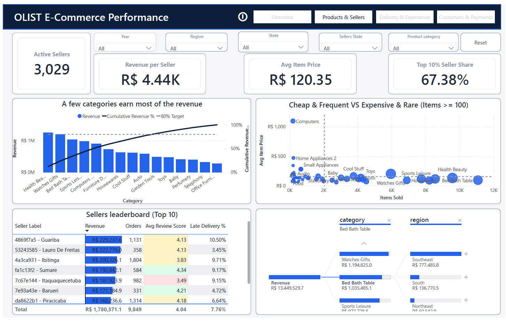
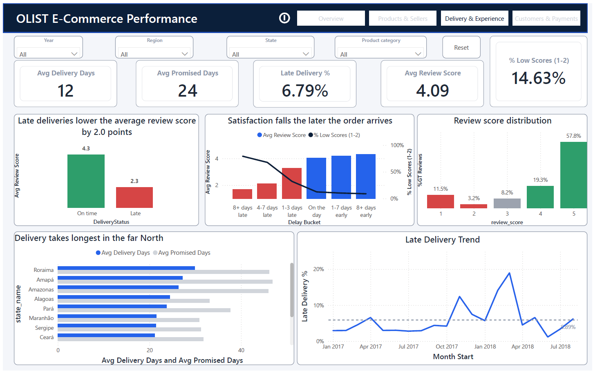
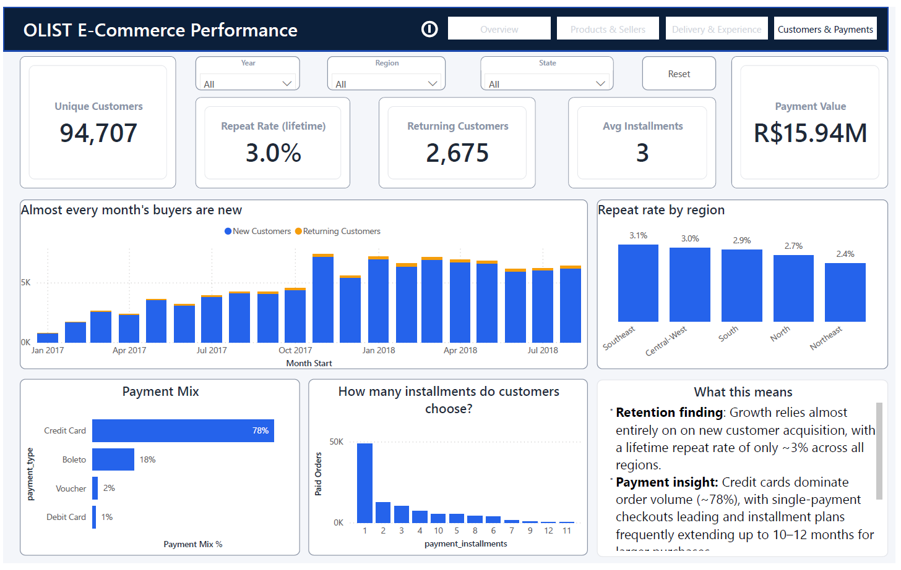

# Olist E-commerce Performance & Customer Experience Dashboard

An end-to-end Power BI project built on the Brazilian E-Commerce Public Dataset by Olist. It turns 9 raw CSV files into a four-page interactive dashboard that shows how the business grew, where the money comes from, what late deliveries do to customer satisfaction, and why almost no customer comes back.

| | |
| --- | --- |
| **Download the Power BI report (.pbix)** |https://drive.google.com/file/d/1koux_KYgBes8SJpT79aqC14BFOvXJ6NT/view?usp=sharing|
| **Watch the screen-recorded walkthrough** | (https://drive.google.com/file/d/1L-vsOCXXUuhVIGIJWuynXysOGW9R5CVw/view?usp=sharing) |

> To open the .pbix you need the free Power BI Desktop



---

## Table of contents

1. [Problem statement](#1-problem-statement)
2. [Dataset](#2-dataset)
3. [Objectives and KPIs](#3-objectives-and-kpis)
4. [Tools and approach](#4-tools-and-approach)
5. [Data preparation in Power Query](#5-data-preparation-in-power-query)
6. [Data model](#6-data-model)
7. [Dashboard walkthrough](#7-dashboard-walkthrough)
8. [Key findings](#8-key-findings)
9. [Recommendations](#9-recommendations)
10. [Validation](#10-validation)
11. [Limitations](#11-limitations)
12. [Repository structure](#12-repository-structure)
13. [Conclusion](#13-conclusion)

---

## 1. Problem statement

Olist connects small Brazilian sellers to large online marketplaces. Executives in charge need one place to answer a handful of questions:

- Is the business growing, and when did the growth happen?
- Which product categories and regions earn the money?
- How long it takes orders to be delivered, and what does a late order cost in customer satisfaction?
- Do customers come back after their first purchase?
- Are sellers generating equal revenue?

The raw data is spread across 9 related files with duplicated reviews, text-formatted dates, missing category translations and a customer ID that changes with every order. This project cleans and models that data, then presents the answers in a dashboard a non-technical manager can read in seconds.

## 2. Dataset

Source: [Brazilian E-Commerce Public Dataset by Olist (Kaggle)](https://www.kaggle.com/datasets/olistbr/brazilian-ecommerce). It holds about 100,000 orders placed between September 2016 and October 2018. All amounts are in Brazilian reais (R$).

| # | File | One row is a... | Role in the model |
| --- | --- | --- | --- |
| 1 | `olist_orders_dataset.csv` | order | Hub table (dates, status, delivery) |
| 2 | `olist_order_items_dataset.csv` | item inside an order | Main fact table |
| 3 | `olist_order_payments_dataset.csv` | payment line | Fact table |
| 4 | `olist_order_reviews_dataset.csv` | review | Fact table |
| 5 | `olist_customers_dataset.csv` | customer ID (one per order) | Dimension |
| 6 | `olist_sellers_dataset.csv` | seller | Dimension |
| 7 | `olist_products_dataset.csv` | product | Dimension |
| 8 | `product_category_name_translation.csv` | category | Lookup used in Power Query |
| 9 | `olist_geolocation_dataset.csv` | coordinate sample | Lookup used in Power Query |

**Analysis window:** January 2017 to August 2018. Late 2016 and the last weeks of 2018 contain only a trickle of orders and would distort trends, so every page filters them out.

## 3. Objectives and KPIs

| # | Business question | KPIs | Page |
| --- | --- | --- | --- |
| 1 | Is the business growing, and when? | Revenue, Orders, AOV, Revenue YoY %, MoM % | 1 Executive Overview |
| 2 | Which categories earn the money, and which sell often but earn little? | Revenue by category, Pareto share, Items sold, Avg price | 2 Products and Sellers |
| 3 | Which regions drive revenue, and where is shipping expensive? | Revenue by state, Freight % of revenue | 1 and 2 |
| 4 | How long it takes orders to be delivered, and what does lateness cost in satisfaction? | Avg delivery days, Late delivery %, Review score on time vs late | 3 Delivery and Experience |
| 5 | Do customers come back? | Repeat rate, New vs returning customers | 4 Customers and Payments |
| 6 | Are sellers generating equal revenue? | Active sellers, Top 10% seller share | 2 Products and Sellers |

**KPI definitions**

- **Revenue:** sum of item `price` for orders that are not canceled or unavailable. Freight is reported separately.
- **Orders:** distinct orders with at least one item, excluding canceled and unavailable.
- **AOV:** Revenue divided by Orders.
- **Late delivery %:** delivered orders whose delivery date is after the estimated date, divided by all delivered orders. Compared date to date, because the estimate has no time of day.
- **Repeat rate:** customers with two or more orders divided by all unique customers, always using `customer_unique_id`.

## 4. Tools and approach

- **Power BI Desktop:** Power Query (M), data modeling, DAX, report design
- **DAX:** about 40 measures organized in display folders (Sales, Time intelligence, Products and sellers, Delivery, Reviews, Customers, Payments, Titles and colors)
- **Python (pandas):** independent validation of the headline numbers

Workflow: import, clean, model, write measures, explore, design, validate, post.

## 5. Data preparation in Power Query

All 9 CSVs were loaded as queries and organized into three groups: **Staging** (parameters, helper function, lookups), **Dimensions** and **Facts**. Key cleaning steps:

- A `FolderPath` parameter and a reusable `LoadCSV` function make the file portable and every query short.
- **orders:** timestamps typed as datetime; `customer_unique_id` merged in; new columns `DeliveryDays`, `PromisedDays`, `DaysVsEstimate`, `IsLate`, `DeliveryStatus` and `IsValidSale`. Lateness compares dates, not timestamps.
- **order_reviews:** reduced to one review per order (the most recent), fixing duplicated order IDs.
- **products:** misspelled column names fixed, English category names merged in, two categories missing from Olist's own translation file added, 610 uncategorized products labeled `Uncategorized`.
- **geolocation:** about 1,000,000 rows collapsed to one row per zip prefix with the average coordinate, filtered to Brazil. Coordinates were merged into `customers` and `sellers`, so no extra geography table is needed.
- **customers and sellers:** state names and the five Brazilian regions added from a 27-row `States` lookup.
- **order_payments:** removed 3 `not_defined` rows and cleaned payment type labels.

The staging queries (`LoadCsv`, `States`, `geolocation`, `category_translation`) are not loaded into the model.

## 6. Data model

A star-style model with a Date table and a dedicated measures table. Each fact reaches the Date table only through `orders`, which keeps a single, unambiguous filter path.



| # | From (many) | To (one) | Cardinality | Filter direction |
| --- | --- | --- | --- | --- |
| 1 | orders[PurchaseDate] | Date[Date] | Many to one | Single |
| 2 | order_items[order_id] | orders[order_id] | Many to one | Single |
| 3 | order_items[product_id] | products[product_id] | Many to one | Single |
| 4 | order_items[seller_id] | sellers[seller_id] | Many to one | Single |
| 5 | order_payments[order_id] | orders[order_id] | Many to one | Single |
| 6 | order_reviews[order_id] | orders[order_id] | One to one | Both |
| 7 | orders[customer_id] | customers[customer_id] | One to one | Both |

Design decisions worth noting:

- **People are counted with `customer_unique_id`**, not `customer_id`, which changes with every order. Using the wrong one makes the repeat rate look like 0%.
- **Delivery and review measures use `CROSSFILTER` inside the measure** so category and seller slicers reach them, instead of making relationships bi-directional across the whole model.
- Auto date/time and relationship autodetect were switched off, so every relationship is deliberate.



## 7. Dashboard walkthrough

The report has four pages on one consistent 1280 x 800 grid. Slicers for Year, Region and State sync across pages, and a Reset button clears every filter.

### Page 1: Executive Overview

**Answers objectives 1 and 3:** is the business growing, and where is the money?


- KPI cards for Revenue (with year-over-year change), Orders, AOV, Avg Review Score and Late Delivery %
- Monthly revenue trend against the same period last year, showing the November 2017 Black Friday peak
- Revenue by state on a map, plus the top 10 categories
- A takeaways box summarizing the story

### Page 2: Products and Sellers

**Answers objectives 2, 3 and 6:** which categories earn the money, and how concentrated is the seller base?



- Pareto chart: bars for revenue, line for cumulative share, with an 80% reference line
- Scatter plot of volume against average price, split into quadrants by the averages
- Seller leaderboard with data bars and review-score color rules
- Decomposition tree to explore revenue by category, region and state
- KPI cards for Active Sellers, Revenue per Seller and Top 10% Seller Share

### Page 3: Delivery and Experience

**Answers objective 4:** how long it takes orders to be delivered, and what does lateness cost?



- Hero chart: average review score for on-time versus late orders, with a dynamic headline showing the gap
- Delay buckets, from 8+ days early to 8+ days late, against review score and share of low scores
- Distribution of review scores 1 to 5
- Slowest states by delivery time against the delivery time Olist promised
- Monthly late-delivery trend

### Page 4: Customers and Payments

**Answers objective 5:** do customers come back, and how do they pay?



- New versus returning customers by month
- Repeat rate by region
- Payment mix and installment choices
- Recommendations box

### Interactivity

- Synced Year, Region and State slicers, plus a Reset bookmark
- A drillthrough page (Category Detail) and a tooltip page for monthly detail
- Field parameter to switch a chart between Revenue, Orders and AOV
- Dynamic titles that update as filters change

## 8. Key findings


1. **Growth peaked with Black Friday 2017.** Revenue climbed through 2017, spiked in November 2017 and then plateaued at roughly R$900k average per month in 2018.
2. **Revenue is concentrated.** The top 10 categories earn 80% of revenue, led by health and beauty, watches and gifts, bed bath table and sports leisure.
3. **Geography drives cost.** São Paulo generates about ~38% of revenue, while freight takes ~23% of revenue in the far north against ~14% in São Paulo.
4. **Late delivery hurts satisfaction.** Late orders score 2.3% against 4.2 for on-time orders, a gap of about 2 points, and the score keeps falling as delays lengthen.
5. **Customers rarely return.** Only about 3% of customers place a second order, so the business is acquisition-driven with little loyalty.
6. **Sellers are concentrated.** The top 10% of sellers generate about ~67% of revenue.

## 9. Recommendations

1. **Prioritize delivery reliability** in the slowest states and during peak events. It is the strongest visible driver of low reviews.
2. **Launch a retention program**, such as a win-back offer after the first successful delivery, because the repeat rate is the largest untapped lever.
3. **Concentrate promotion and seller recruitment** in the categories that already earn most of the revenue.
4. **Review freight pricing or regional fulfillment** for remote states, where shipping cost eats a large share of order value.
5. **Reduce dependence on a few sellers** by onboarding and supporting mid-sized sellers.

## 10. Validation

Headline numbers were recomputed independently in Python (pandas) and compared with the dashboard with no filters applied: Revenue, Orders, Late delivery %, Repeat rate and gross item value all matched. Row counts for every table were checked after cleaning, and slicers were tested to confirm every card and chart responds. The script is in `scripts/validate.py`.

## 11. Limitations

- The data is a public, anonymized sample, so figures are illustrative rather than Olist's actual performance.
- There is no cost or margin data, so profitability cannot be assessed.
- The data ends in 2018, and the first and last months are incomplete, so they are excluded.
- The review gap shows correlation. Lateness is the strongest visible driver of low scores, but product and seller quality can also play a part.
- Definitions (valid sale, late delivery, repeat customer) are choices documented above, and other definitions would shift the numbers slightly.

## 12. Repository structure

```text
.
├── README.md
├── gitignore
├── report/
│   ├── screenshots/
│   │   ├── executive-overview.png
│   │   ├── products-&-sellers.png
│   │   ├── delivery-&-experience.png
│   │   ├── customers-&-payments.png
│   │   ├── data-model.png
│   │   └── measures.png
│   └── olist report.pdf
│   └── olist dashboard.mp4
│   └── olist-theme.json
│   └── Olist-Performance-Dashboard.pbix
└── scripts/
    └── validate.py
```

The raw CSVs are not included. Download them from the Kaggle link above and point the `FolderPath` parameter in Power Query at your local folder.

## 13. Conclusion

This project took nine messy, related CSV files and turned them into a clean model and a four-page dashboard that answers six business questions. The story is consistent across the pages: Olist grew quickly in 2017, revenue is concentrated in a few categories, regions and sellers, late deliveries sharply lower customer satisfaction, and very few customers return for a second purchase.

The practical takeaway is that the business is better at winning customers than keeping them. Fixing delivery reliability, especially in distant states, and building a retention program would address the two biggest weaknesses the data shows. On the technical side, the project demonstrates data cleaning in Power Query, a deliberate star-style model, DAX for time intelligence and customer analysis, independent validation, and a dashboard designed to be read in seconds.

Feedback and questions are welcome. You can reach me at ioakinkunmi@gmail.com. Thank you.